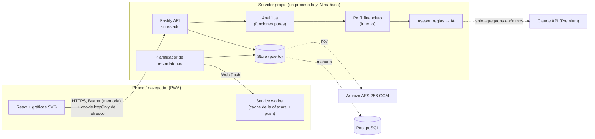

# Arquitectura

## Visión general

### Decisiones clave

| Decisión | Alternativa descartada | Por qué |
| --- | --- | --- |
| **PWA** (React + Vite) como cliente | Nativo (Swift) / Flutter / React Native | Un único código para iOS, Android y escritorio; despliegue inmediato desde tu servidor; instalable y con push en iOS ≥ 16.4. Si hace falta la App Store, se empaqueta con **Capacitor** sin reescribir. |
| **Dinero en enteros** (céntimos) | `number` decimal | Evita errores de redondeo; el contrato compartido lo impone con zod. |
| **Gráficas SVG propias** (d3-scale/shape/sankey) | Librería de gráficos «de catálogo» | Control total del aspecto, accesibilidad (vista en tabla, teclado) y animación; el diseño era prioridad. |
| **Puerto `Store`** asíncrono con `FileStore` | Elegir BD ya | La BD se decide después. Toda la app habla con la interfaz; cambiar a Postgres = una clase nueva + migraciones. |
| **Analítica como funciones puras** | Consultas SQL a medida | Testeables sin infraestructura; se pueden mover a SQL/materializadas cuando el volumen lo pida. |
| **Perfil financiero solo en servidor** | Calcularlo en el cliente | Es la base de los consejos y no debe ser visible ni manipulable. Un test garantiza que ninguna ruta de la API lo serializa. Excepción opt-in: el panel del administrador (proceso aparte, red privada) puede mostrarlo con `PANEL_VER_PERFILES`. |
| **IA detrás de un asesor de reglas** | Solo IA | Funciona sin conexión, sin coste y sin enviar datos; la IA solo enriquece (Premium) y, si falla, se cae a reglas. |

## Well-Architected: los seis pilares

### 1. Excelencia operativa
- Monorepo con TypeScript estricto, CI (`typecheck` + tests + build) en cada push.
- Logs estructurados (pino) con campos sensibles redactados; `/healthz` y `/readyz`.
- Configuración 12-factor validada con zod: la app **no arranca** en producción si faltan secretos o el origen no es HTTPS.
- Apagado ordenado (SIGTERM): deja de aceptar tráfico y vuelca los datos a disco.
- *Pendiente:* métricas (Prometheus/OpenTelemetry), alertas, runbooks.

### 2. Seguridad
Detallado en [`SECURITY.md`](SECURITY.md). Resumen: scrypt, MFA TOTP con anti-replay, access token de 10 min solo en memoria, refresh rotatorio con detección de reutilización, aislamiento por usuario en cada consulta, CSP estricta, cifrado en reposo, mínima exposición de datos a la IA, RGPD (exportar/borrar).

### 3. Fiabilidad
- Escritura atómica del almacén (archivo temporal + `rename`), así un corte de luz no corrompe los datos.
- API sin estado salvo el almacén ⇒ reiniciable en cualquier momento; el service worker mantiene la interfaz disponible sin red.
- La IA tiene *timeout* y degradación automática a reglas.
- El recordatorio es idempotente (una vez al día por usuario) y poda suscripciones caducadas (404/410).
- *Pendiente:* copias de seguridad automáticas y cifradas del archivo/BD; prueba de restauración.

### 4. Eficiencia de rendimiento
- Respuesta de analítica calculada en una pasada por los movimientos del usuario.
- Web: *code-splitting* por ruta, assets con hash e inmutables, precaché del service worker, tipografías variables autohospedadas (sin terceros).
- Caché de consejos por usuario (invalida al cambiar los datos) para no repetir llamadas a la IA.
- *Camino de escala:* índices por `(user_id, date)`, agregados mensuales materializados, caché de `overview` en Redis.

### 5. Optimización de costes
- Un solo proceso Node en un PC/mini-servidor; sin servicios gestionados obligatorios.
- La IA solo en Premium, con caché de 6 h y resumen mínimo (cientos de tokens, no historiales).
- Reglas deterministas cubren el plan gratuito con coste cero.

### 6. Sostenibilidad
- Cliente ligero (≈150 kB gzip de JS), sin trackers ni fuentes de terceros.
- Cálculo bajo demanda y caché frente a procesamiento continuo; el planificador despierta una vez por minuto.

## Camino de escalado

| Paso | Cambio | Sin tocar |
| --- | --- | --- |
| 1 | `PostgresStore` (mismo puerto) + migraciones | Rutas, analítica, web |
| 2 | Rate limit y caché de consejos en Redis; sesiones en BD | Contratos de API |
| 3 | 2+ instancias de API tras balanceador (ya es stateless) | — |
| 4 | Planificador de recordatorios → cola (BullMQ/SQS) con workers | Lógica de recordatorios (`runReminders` ya es pura) |
| 5 | Agregados materializados para `overview` | Respuesta de la API |
